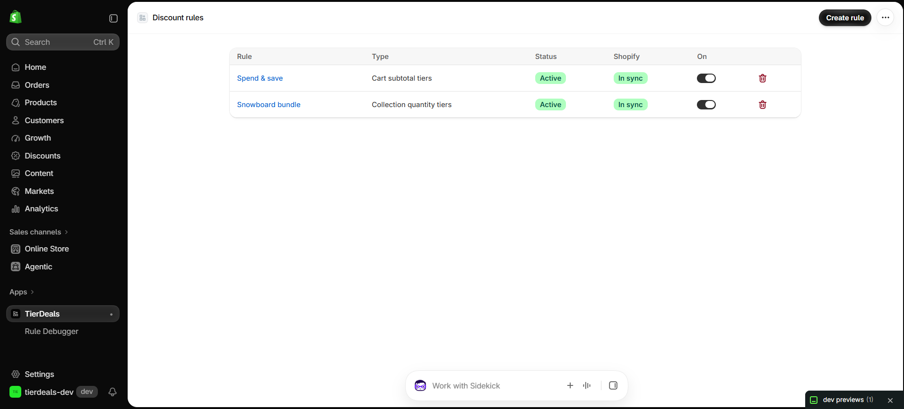
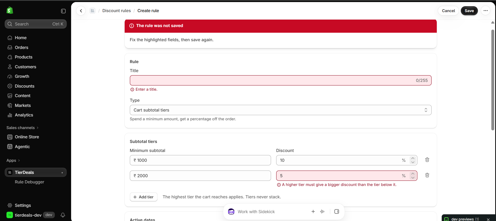
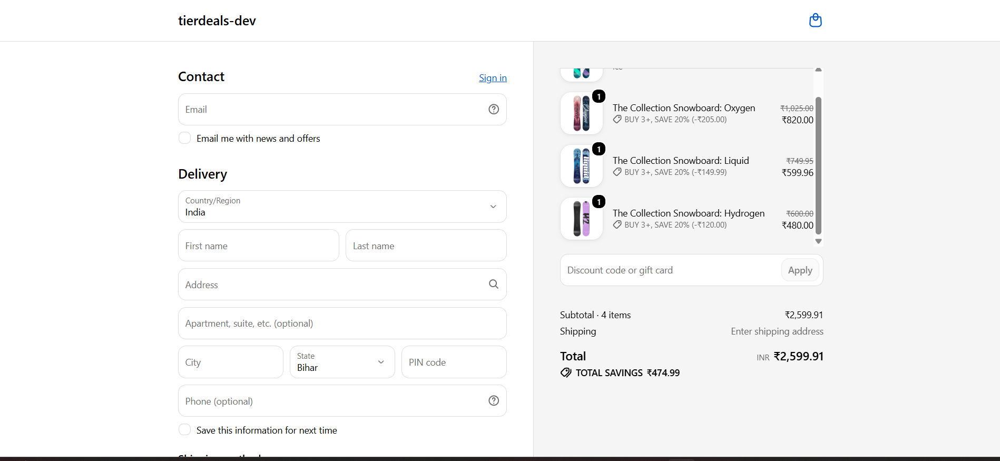
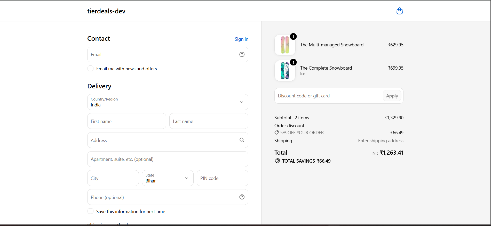
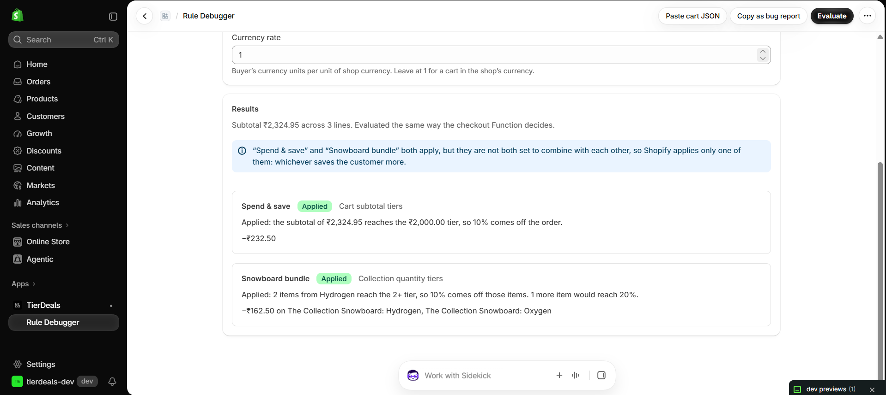
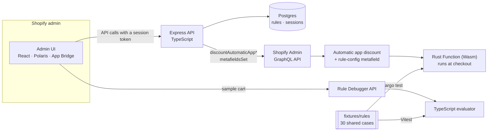

# TierDeals

[](https://github.com/Divyanshu-2907/TierDeals/actions/workflows/ci.yml)

Tiered discounts for Shopify. Merchants set up rules in an admin embedded in
Shopify, a Rust Shopify Function applies them at checkout, and a Rule
Debugger explains why a discount did or did not apply.

## Features

- **Three rule types:** buy N+ items from chosen collections for a tiered
  percentage off those items (2+ → 10%, 3+ → 20%); spend tiers for a percentage
  off the order; and a free shipping threshold.
- **Admin UI** inside the Shopify admin (React, Polaris web components, App
  Bridge): list, create and edit rules, a tier editor, inline validation, and
  on/off switches. Rules whose Shopify discount failed to update are flagged
  with the reason and a retry button.
- **Rust Shopify Function** compiled to WebAssembly. It reads each rule from
  a JSON metafield on its discount, picks the best tier, never stacks tiers,
  and applies nothing (rather than failing) when the config is bad.
- **Rule Debugger:** build or paste a sample cart and see, for every rule,
  whether it applies, which tier, the amount, and a plain-English reason
  ("Not applied: 1 item from Hydrogen, needs 2."). Results export as a JSON
  bug report that reproduces elsewhere.

## Screenshots

<table>
  <tr>
    <td width="50%" valign="top">
      
      <br><sub>Rules list: status, Shopify sync state and on/off switches.</sub>
    </td>
    <td width="50%" valign="top">
      
      <br><sub>Create form: validation errors shown next to each field.</sub>
    </td>
  </tr>
  <tr>
    <td width="50%" valign="top">
      
      <br><sub>Checkout: “Buy 3+, save 20%” on the Hydrogen boards (−₹474.99).</sub>
    </td>
    <td width="50%" valign="top">
      
      <br><sub>Checkout: a subtotal tier applied as “5% off your order”.</sub>
    </td>
  </tr>
  <tr>
    <td width="50%" valign="top">
      
      <br><sub>Rule Debugger: each rule's decision, amount and reason.</sub>
    </td>
    <td width="50%" valign="top">
      
      <br><sub>Bug report export, with Download as .json.</sub>
    </td>
  </tr>
</table>

## How it works



1. A merchant saves a rule. The API writes it to Postgres, then creates or
   updates a Shopify **automatic app discount** whose JSON metafield holds the
   rule. If Shopify refuses (for example, the store has hit its limit of app
   discounts), the rule is kept and marked **out of sync** with Shopify's
   reason, and a retry repeats the same push.
2. At checkout, Shopify runs the **Rust Function** with the cart and that
   metafield. The metafield also feeds the query variable that checks
   collection membership, so each discount checks its own collections.
3. The **Rule Debugger** runs a TypeScript port of the Function's logic on the
   server and explains each decision.

## Why Rust, and how the debugger stays honest

Shopify Functions run as WebAssembly under tight limits (256 kB, an
instruction budget per run). Rust compiles to small, fast Wasm with no
runtime or garbage collector: this Function is about 110 kB and uses around
100,000 instructions per run. The type system also helps with "never break
checkout": config parsing returns a `Result` instead of panicking, so a bad
config is logged and applies no discount, which the fixtures check for nine
kinds of malformed config.

That leaves the same logic in two languages: Rust for checkout, TypeScript
for the debugger. They are kept in step by
**[30 shared fixtures](fixtures/README.md)**: language-neutral JSON cases
(rule config and cart in, expected decision out). They cover every rule
type, exact thresholds and one unit or one cent below, empty carts, tiers in
any order, currency conversion including floating-point rounding, and nine
kinds of malformed config. `cargo test` runs every case through the
Function's own parser and evaluator; Vitest runs the same files through the
TypeScript port. If either implementation changes how it decides, a test
fails, and each new edge case is written once for both languages.

## How I'd debug a merchant report

> *"A customer bought three Hydrogen snowboards but only got 10%, not 20%."*

1. **Reproduce it.** In the Rule Debugger, add the customer's products,
   Oxygen (₹1,025), Hydrogen (₹600) and The Complete Snowboard (₹699.95), and
   click Evaluate.
2. **Read the explanation.** The Snowboard bundle card says:
   *"Applied: 2 items from Hydrogen reach the 2+ tier, so 10% comes off those
   items. 1 more item would reach 20%."* The Complete Snowboard is in
   Automated Collection, not Hydrogen, so only two of the three boards count.
   The rule is working; the customer's assumption isn't.
3. **Check for interactions.** If a spend-tier rule is also on, a note
   explains that the two discounts do not combine, so Shopify applies only
   the one that saves the customer more. That can make the checkout total
   look "wrong" when each rule is right.
4. **Hand it over without screenshots.** *Copy as bug report* exports the
   cart (with each product's collections at that moment), every rule and the
   result. Pasting it into the debugger on another machine reproduces the
   same result, even if the store's collections have changed since:

   ```json
   {
     "kind": "tierdeals-bug-report",
     "cart": { "lines": [{ "productId": "gid://shopify/Product/…", "quantity": 1,
       "unitPrice": 699.95, "collectionIds": ["gid://shopify/Collection/…"] }] },
     "rules": [ … ],
     "result": { "results": [{ "title": "Snowboard bundle", "outcome": "applied", … }] }
   }
   ```

5. **If the debugger and checkout disagree,** that's a real bug. Check the
   rule's *sync* badge first (Shopify may have an older version; retry the
   sync). Otherwise replay the checkout with `shopify app function replay`,
   turn that input into a new fixture, and fix whichever implementation
   fails it. The fixture then guards both from then on.

## Bugs found and fixed along the way

- **The Shopify CLI runs each web process from its own folder.** The dev
  command `npm run dev --workspace web/backend` ran from `web/`, so it
  pointed at `web/web/backend`. Fixed with a `shopify.web.toml` per package.
- **`tsx watch` hung on Windows under `shopify app dev`.** The CLI gives each
  process an open stdin pipe that is not a terminal, and `tsx watch` stalled
  on it without an error. I reproduced it by spawning the server the same way
  the CLI does, and switched to `node --watch --import tsx`.
- **Switching rule type emptied the form.** The select handler read
  `event.currentTarget` inside a React state updater, which React may run
  after the event has finished, when `currentTarget` is `null`. The type
  became `''` and no type-specific fields rendered. Fixed by reading the
  value first; a regression test forces the late-updater case.
- **React 19 crashed on Polaris amount fields.** React assigns props on custom
  elements as properties when the element has one, and every DOM element has
  a read-only built-in `prefix`. Passing `prefix={currency}` threw. Fixed by
  using `<s-money-field>`, which shows the shop's currency itself.
- **CI-only test failure.** On an empty database, parallel test files raced
  to create Shopify's session tables. Found by running the CI steps in a fresh
  clone; the tables are now created once before the tests start.

## Local setup

**Prerequisites:** Node 22.22+, Docker Desktop, Rust (stable) with
`rustup target add wasm32-unknown-unknown`, the Shopify CLI, and a Shopify
Partner account with a development store.

```bash
npm install
npm run db:up                    # Postgres 17 on localhost:5433
cp .env.example .env             # then add the values from `shopify app env show`
npm run db:migrate
shopify app config link          # once: create or choose the app
shopify app dev --use-localhost  # or plain `shopify app dev` for a tunnel
```

`shopify app dev` builds the Function and starts two processes: the Vite dev
server for the admin UI (everything is routed to it, and it forwards `/api`)
and the Express API on port 3000. The full Shopify-side walkthrough is in
[docs/shopify-setup.md](docs/shopify-setup.md).

### Windows notes

- `--use-localhost` serves the app over HTTPS from a local proxy instead of a
  tunnel. The CLI uses `mkcert` for the certificate and offers to install it
  on first run (or pass `--install-mkcert`).
- Docker Desktop must be running for `npm run db:up`.
- Rust needs the MSVC linker from the Visual Studio Build Tools ("Desktop
  development with C++").
- In Windows PowerShell 5.1, quote the separator when passing flags through
  npm: `npm run db:migrate '--' --name my_change`.

## Tests

| Suite | Run with | Covers |
| --- | --- | --- |
| Shared | `npm test -w web/shared` | Zod schemas, rule status, and the 30 shared fixtures through the TypeScript evaluator |
| Backend | `npm test -w web/backend` | Rules API and Shopify sync against a real Postgres test database with a fake Shopify (including out-of-sync, retry and refused deletes), the GraphQL calls, debugger explanations and API, env validation, error handling |
| Frontend | `npm test -w web/frontend` | Form conversion and validation, the type-switch regression, the API client's token retry, the rules list, and the debugger page (paste, evaluate, bug report, download) |
| Function | `cargo test` in `extensions/tierdeals-discount` | Config parsing and tiers, both checkout targets end-to-end from JSON input, and the 30 shared fixtures |
| Function (Wasm) | `npm run test:function` | The compiled Wasm in Shopify's function-runner, with inputs validated against the schema (needs the Shopify CLI) |

`npm test` runs the first three and needs Postgres (`npm run db:up`); it uses
a separate `tierdeals_test` database. CI ([`.github/workflows/ci.yml`](.github/workflows/ci.yml))
runs format, lint, typecheck, the TypeScript suites against a Postgres
service, the production build, and fmt, clippy, `cargo test` and the Wasm
size check for the Function.

## Known limitations and roadmap

- **Free shipping** is covered by unit tests, the shared fixtures and
  function-runner, but not yet at a real checkout: the development store has
  no shipping rates.
- **The out-of-sync path** is covered by API tests with a fake Shopify, but
  not yet forced against real Shopify.
- One rule is one Shopify automatic discount, and Shopify limits active app
  discounts per store; hitting the limit shows up as an out-of-sync reason.
- A rule's type is fixed when it is created (Shopify fixes the discount
  class).
- The debugger prices a picked product at its first variant (editable), and
  its note on non-combining discounts describes Shopify's choice rather than
  computing it.

**Next:** an `orders/create` webhook (HMAC-verified) that logs which rules
applied to each order, and an analytics page with uses and total discount per
rule over the last 30 days. After that, deployment with `shopify app deploy`.

## Repository layout

```text
web/shared/       Zod rule schemas and the TypeScript evaluator, used by both sides
web/backend/      Express API: auth, rules + Shopify sync, Rule Debugger (Prisma, Postgres)
web/frontend/     Admin UI: React 19, Polaris web components, App Bridge (Vite)
extensions/       The Rust discount Function
fixtures/rules/   Shared cases run by cargo test and Vitest
docs/             Shopify setup guide, demo script, screenshots
```

## Licence

MIT
